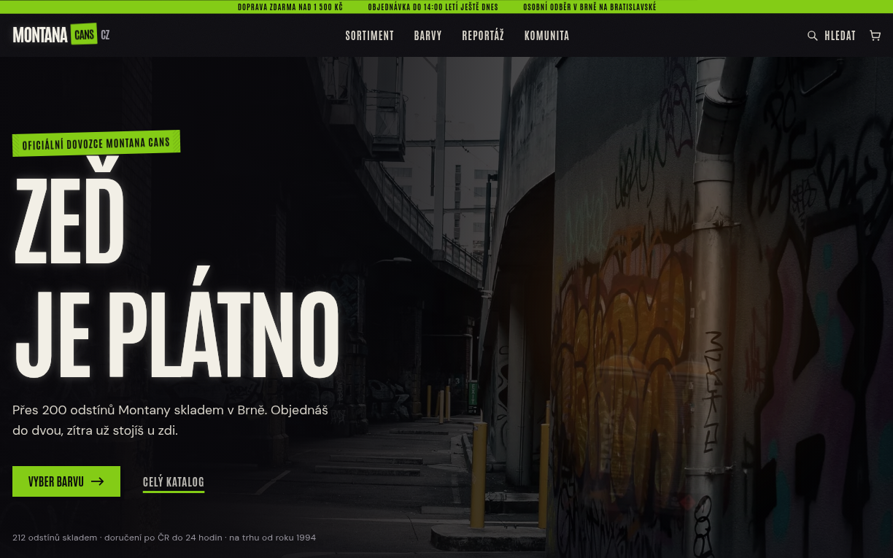

<div align="center">

# Montana Cans CZ — e-shop concept

A redesign concept for a Czech spray paint and graffiti supplies store.


**[Live demo → montana.hribal.site](https://montana.hribal.site)**



</div>

## About

A front-end mockup showing what a modern Czech graffiti supply store could look like: a
poster-style visual identity, hand-drawn product art and an interactive colour wall.
It is a static site with no backend. The catalogue is a TypeScript array, the cart lives in
`localStorage`, and the whole thing builds to plain HTML.

> **Disclaimer:** unofficial concept, not affiliated with, endorsed or sponsored by Montana Cans.
> No official logos or artwork are used. Product names, prices, reviews and addresses are placeholders.

## Features

- **Colour wall:** 112 swatches in eight families. Picking one repaints the whole page at
  runtime via CSS custom properties and filters the products below to that colour.
- **Vector product art:** every product is a parametric SVG (cans, markers, caps, apparel,
  blackbooks) with one shared lighting setup, so there are no product photos at all.
- **Graffiti SVG library:** drips, splatters, overspray, tags and tape, roughened with
  `feTurbulence` / `feDisplacementMap` filters.
- **Catalogue:** category tabs, sorting, price bands, in-stock filter and pagination, all client-side.
- **Cart, quick view and search:** accessible dialogs with focus trap and `Esc` to close. The cart
  persists to `localStorage`. Search opens with `/` and ignores Czech diacritics.
- **Accessibility:** skip link, keyboard-navigable colour wall, `prefers-reduced-motion` respected.

## Tech stack

| Layer | Tools |
| --- | --- |
| Framework | Next.js 15 (App Router, static export), React 19 |
| Language | TypeScript (strict) |
| Styling | Tailwind CSS 3 + CSS custom properties |
| Animation | Motion + CSS animations |
| Hosting | Cloudflare (static assets from `out/`) |

## Getting started

Requires Node.js 20+ and pnpm.

```bash
pnpm install
pnpm dev          # http://localhost:3000
pnpm typecheck    # tsc --noEmit
pnpm build        # static export to out/
```

Set `BASE_PATH=/subfolder` before `pnpm build` to serve the site from a subfolder.

## Project structure

```
app/                 layout, homepage, global styles
components/          page sections, cart, quick view, search
components/art/      parametric SVG product artwork
components/graffiti/ decorative SVG elements and filters
lib/                 colours, products, cart state, photo manifest
public/photos/       photography (Pexels)
```

## License

Code is [MIT](LICENSE). Photos in `public/photos/` are from [Pexels](https://www.pexels.com/license/)
and are covered by the Pexels License. Trademarks belong to their owners.

---

Made by **Miloslav Hříbal** · [github.com/MildaHribal](https://github.com/MildaHribal)
